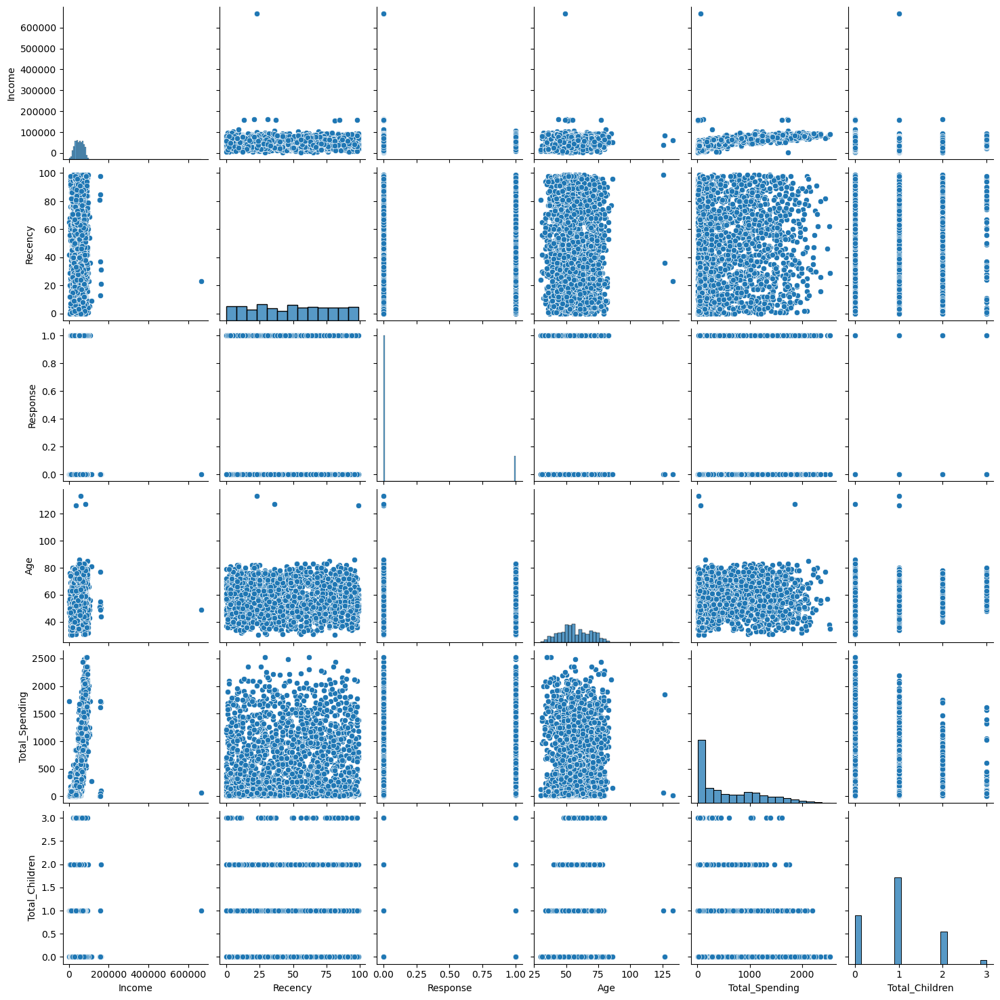
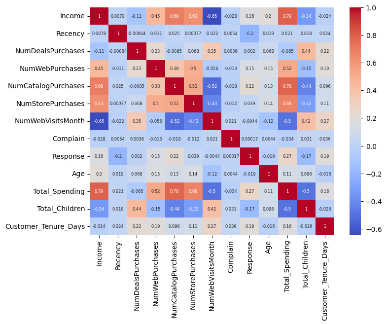
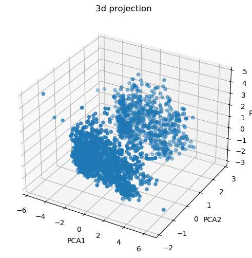
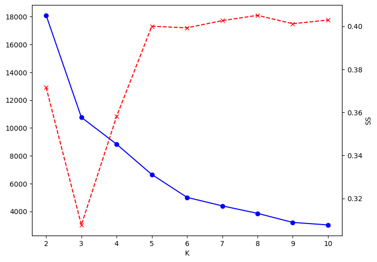
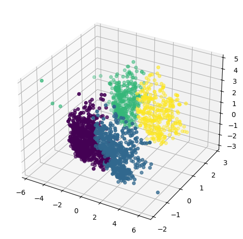
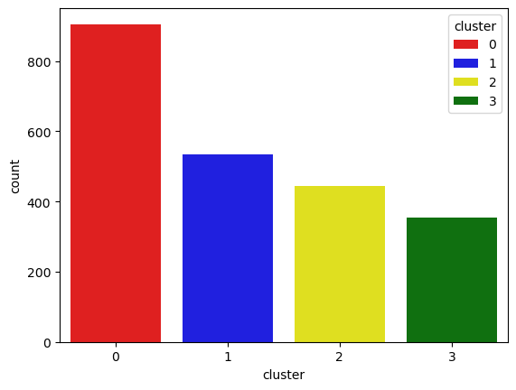
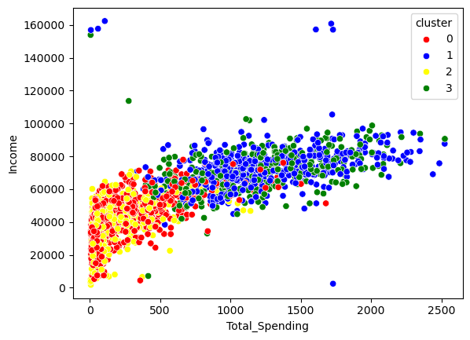

# ClusterCart: E-commerce Customer Segmentation System
### Project Documentation

## Table of Contents
1. [Overview](#1-overview)
2. [Dataset](#2-dataset)
3. [Methodology](#3-methodology)
4. [Model Selection](#4-model-selection)
5. [Cluster Characterization & Profiling](#5-cluster-characterization--profiling)
6. [Business Recommendations](#6-business-recommendations)
7. [Debugging Log & Lessons Learned](#7-debugging-log--lessons-learned)
8. [Limitations & Future Work](#8-limitations--future-work)
9. [Conclusion](#9-conclusion)
10. [References within this repository] (#10-References-within-this-repository) 
---

## 1. Overview

Project title: ClusterCart: E-commerce Customer Segmentation System
Type: Unsupervised machine learning mini-project
Development environment: Anaconda, JupyterLab, and Jupyter Notebook
Implementation: Python
Final clustering approach: Agglomerative Clustering with Ward linkage and four clusters

**Context.** ClusterCart is a growing multi-country e-commerce platform that uses the same marketing for every customer. This single generic marketing approach causes inefficient marketing, missed retention of high-value customers, and late identification of churn-prone users.

**Objective.** As the AI/ML engineer, build an unsupervised segmentation system that groups customers by purchasing behaviour, engagement, and loyalty indicators.

**Why unsupervised?** There is no target variable (no `y`). We want the algorithm to find structure on its own, unlike supervised ML.

## 2. Dataset

2,240 customer records, 22 attributes.

| Category | Features |
|---|---|
| Demographics | ID, Year_Birth, Education, Marital_Status, Income, Kidhome, Teenhome, Dt_Customer |
| Purchase (amount) | MntWines, MntFruits, MntMeatProducts, MntFishProducts, MntSweetProducts, MntGoldProds |
| Purchase (frequency) | NumDealsPurchases, NumWebPurchases, NumCatalogPurchases, NumStorePurchases, NumWebVisitsMonth |
| Feedback / other | Recency, Complain, Response |

## 3. Methodology

### Workflow summary

1. Load and inspect the customer table.
2. Impute missing income values.
3. Engineer age, spending, household-size, household-living, and customer-tenure features.
4. Remove identifier and redundant source columns.
5. inspect selected variables for outliers and apply the age and income filters.
6. calculate correlations for numeric columns and inspect the heatmap.
7. one-hot encode `Living_With` and `Education`.
8. standardize all 18 modelling features.
9. reduce the 18-dimensional data to three principal components.
10. explore K-Means cluster counts with WCSS and silhouette scores.
11. fit K-Means and Agglomerative Clustering with four clusters; compare their visual projections.
12. use Agglomerative labels to profile customers and summarize feature means.

### 3.1 Missing values
`Income` had **24 nulls** (all other columns complete). Filled with the **median**, because income is skewed and extreme values would pull the mean. After imputation, `isnull().sum()` returned 0 for every column.

### 3.2 Feature engineering
Merged or transformed features into more meaningful ones.  The notebook adds five features before dropping the source columns they replace.

| New feature | Derived from | Reason |
|---|---|---|
| `Age` | `2026 − Year_Birth` | Age is more interpretable than birth year |
| `Customer_Tenure_Days` | latest `Dt_Customer` in data − each customer's join date | Loyalty/tenure indicator |
| `Total_Spending` | sum of the six `Mnt*` columns | One clean measure of customer value |
| `Total_Children` | `Kidhome + Teenhome` | Household size indicator |
| `Living_With` | `Marital_Status` → Partner (Married, Together) / Alone (Single, Divorced, Widow, Absurd, YOLO) | Reduces sparse categories |
| `Education` (regrouped) | Basic, 2n Cycle → Undergraduate; Graduation → Graduate; Master, PhD → Postgraduate | 3 levels instead of 5 |

### 3.3 Dropping columns
Dropped: `ID`, `Year_Birth`, `Marital_Status`, `Kidhome`, `Teenhome`, `Dt_Customer`, and the six `Mnt*` columns. Shape went from **(2240, 27) → (2240, 15)**. A new dataframe (`df_cleaned`) was created because `drop()` returns a copy and does not modify the original.

### 3.4 Outliers
Pair plots on `Income, Recency, Response, Age, Total_Spending, Total_Children` revealed a few extreme points. Removed:
- `Age ≥ 90` (implausible lifespan for active customers)
- `Income ≥ 600,000` (extreme outlier far from the rest)

Rows: **2,240 → 2,236**. These columns were chosen because they are continuous and meaningful, so outliers show visibly there. Binary/count columns would not benefit from the same check.

### 3.5 Correlation heatmap
`df_cleaned.corr(numeric_only=True)` (numeric columns only). The most correlated pair was **Income and Total_Spending**, so it became the primary lens for later cluster analysis.

### 3.6 Encoding
The two remaining categorical columns, `Living_With` and `Education` were One-Hot Encoded. `OneHotEncoder` returns a sparse matrix, not a DataFrame, so it was converted with `.toarray()`, given proper column names via `get_feature_names_out()`, aligned with `index=df_cleaned.index`, and concatenated back. Result: **18 features**.

### 3.7 Scaling
`StandardScaler`: clustering uses distances, so features on large scales (e.g. Income and Spending values have much larger numeric magnitudes than binary indicators or purchase counts.) would otherwise dominate.

### 3.8 Dimensionality reduction (PCA)
With 18 features we can't plot directly. PCA was used both for visualisation and as the input to clustering.

| Component | Explained variance |
|---|---|
| PC1 | 23.2% |
| PC2 | 11.4% |
| PC3 | 10.4% |
| **Total (3 PCs)** | **≈ 45.9%** |

Two components captured too little variance, so **3 components** were used (3D scatter).

## 4. Model Selection

### 4.1 Choosing k
- **Elbow method:** WCSS for k = 1 to 10 (business wants about 5–6 groups at most). `KneeLocator` from `kneed` was also tried.
As K increases, WCSS decreases because more clusters generally allow points to be closer to their assigned cluster centres. The Elbow method looks for a point after which the improvement begins to flatten. The saved curve shows a large reduction at the beginning and a more gradual decline as K increases; it does not present a perfectly sharp elbow.
- **Silhouette score:** computed from **k = 2** (undefined for k = 1).
- **Combined plot:** WCSS and silhouette plotted on one figure with `twinx()` (two y-axes). The elbow curve showed k = 4 as the most acceptable value, and **k = 4** was chosen as the point nearest the intersection of the two curves, balancing compactness and separation.

A visual crossing between the lines on a dual-axis chart is not a formal mathematical rule for choosing K: the apparent crossing depends on the separate axis scales. The Elbow shape, silhouette values, segment interpretability, and downstream usefulness should be considered together. The original combined chart is therefore not used as conclusive evidence for K=4.

### 4.2 Algorithms compared

| Algorithm | Outcome |
|---|---|
| K-Means (k=4) | Worked, but clusters were less clearly separated in 3D PCA space |
| **Agglomerative, Ward (k=4)** | **Most clearly separable, best-formed clusters → selected** |
| DBSCAN | Cannot pre-set cluster count; produced **30+ clusters**, too many to analyse or act on (explored during experimentation; removed from the final notebook) |

**Decision:** Agglomerative clustering with 4 clusters. Agglomerative Clustering produced clusters that looked more clearly separated and better formed in the visualization than the K-Means result. On that visual basis, Agglomerative labels were selected for the remaining characterization and profiling steps as the 4 segments are easy to analyse, explain, and turn into marketing strategy.

## 5. Cluster Characterization & Profiling

Agglomerative labels were added as a `cluster` column and `groupby("cluster").mean()` produced the profile. Colours: 0 = red, 1 = blue, 2 = yellow, 3 = green. 
The mean of each feature grouped by cluster:

| Metric | C0 🔴 | C1 🔵 | C2 🟡 | C3 🟢 |
|---|---|---|---|---|
| Income | 39,681 | 72,808 | 36,960 | 70,723 |
| Total spending | 222 | 1,237 | 166 | 1,190 |
| Deals purchases | 2.59 | 1.96 | 2.59 | 1.86 |
| Web purchases | 3.15 | 5.69 | 2.71 | 5.79 |
| Catalog purchases | 0.97 | 5.50 | 0.84 | 5.01 |
| Store purchases | 4.14 | 8.66 | 3.62 | 8.43 |
| Web visits / month | 6.31 | 3.58 | 6.66 | 3.73 |
| Total children | 1.24 | 0.51 | 1.27 | 0.46 |
| Campaign response | 7.6% | 16.7% | 14.2% | 32.0% |
| Recency (days) | 48.9 | 49.2 | 48.3 | 50.5 |
| Age | 55.7 | 59.5 | 55.7 | 58.9 |
| Tenure (days) | 343 | 370 | 339 | 376 |
| Living with partner | 100% | 100% | 0.7% | 0% |
| Complaints | 1.1% | 0.6% | 1.1% | 0.6% |

**Segments**
- **C1 🔵 High-value partnered:** high income and spend, heavy catalog/store buyers, few children.
- **C3 🟢 High-value solo, campaign responders:** same value profile as C1, living alone, highest response rate (32%).
- **C0 🔴 Budget partnered families:** low income and spend, more children, deal-driven, many web visits but few purchases.
- **C2 🟡 Budget solo shoppers:** lowest spend, highest web visits, deal-driven.

**Observations**
1. Income vs Total Spending scatter plot shows two clear value tiers, each split into two groups.
2. Recency, tenure, and complaints barely differ across clusters, so they aren't what separates segments.
3. The pairs (0, 2) and (1, 3) are nearly identical except for `Living_With`. Segments are therefore effectively **2 value tiers × 2 living situations**.
4. **Education distributions are broadly similar.** Education alone does not appear to define the four profiles as strongly as income, spending, purchase frequency, and household arrangement.
> Note: cluster sizes were read approximately from the count plot in the notebook, so exact customer counts per cluster are not reported here.

## 6. Business Recommendations
- **C1 and C3 (high-value):** loyalty programmes, premium/catalog offers, early access. Target C3 first for campaigns since it responds most.
- **C0 and C2 (low-value, high web visits, low conversion):** discounts, bundles, free-shipping thresholds to convert browsers into buyers. C0 may respond to family-oriented bundles.
- **Retention:** monitor Recency within each segment to catch churn-prone customers early.

## 7. Debugging Log & Lessons Learned

| # | Problem | Cause | Fix / Lesson |
|---|---|---|---|
| 1 | Date parsing gave wrong results | `Dt_Customer` is in day-first format (e.g. `04-09-2012`) | `pd.to_datetime(..., dayfirst=True)` |
| 2 | `matplotlib` import error | Tried importing the wrong module | Use `import matplotlib.pyplot as plt` and `import seaborn as sns` |
| 3 | Heatmap failed on text columns | `corr()` can't handle strings | `corr(numeric_only=True)` |
| 4 | Encoded columns couldn't be added to the data | `OneHotEncoder` returns a sparse array, not a DataFrame | `.toarray()` + `get_feature_names_out()` + `index=df_cleaned.index` |
| 5 | `drop()` seemed to do nothing | It returns a copy | Assign to a new DataFrame; keep separate dataframes per cleaning stage |
| 6 | `groupby("cluster").mean()` errored on `df_cleaned` | Contains string columns (Education, Living_With) | Use the encoded numeric frame (`X = df_encoded`) so every column is numeric |
| 7 | Silhouette score error | Cannot be computed for k = 1 | Start the silhouette loop at k = 2 |
| 8 | Combined plot misaligned | WCSS list (k=1..10) and scores (k=2..10) had different lengths | Slice `wcss[:len(k_range)]`, use `twinx()` for the second axis. Also fixed typos `ax1.set_label` → `set_ylabel` and `marker - "x"` → `marker = "x"` |
| 9 | `kneed` not found | Not installed | `%pip install kneed[plot]` |

**Other lessons**
- Unsupervised ML has no `y`; evaluation relies on internal metrics and interpretation.
- PCA is useful for both visualisation and modelling.
- DBSCAN's lack of a fixed k can hurt actionability.
- `X = df_encoded` is a reference, not a copy, so adding `X["cluster"]` also modifies `df_encoded`. Use `.copy()` to avoid surprises.
- Keeping intermediate DataFrames
The workflow uses separate objects such as `df`, `df_cleaned`, `df_encoded`, and `X_scaled`. This makes it easier to inspect what each transformation changed and avoids losing the raw data during preprocessing. The explicit `.copy()` recommendation in the profiling section also avoids accidental mutation through aliases.
- Cluster summary and `X.groupby("cluster")`
If the selected DataFrame contains string categories, a plain numeric mean is not defined for those columns. Use the encoded numeric data or aggregate numeric columns explicitly.

The one-hot column means in the output are category proportions, not arbitrary numeric scores.

## 8. Limitations & Future Work
- One-hot features influence the split strongly (see Observation 3). Test clustering without them.
- Only ~46% of variance retained by 3 PCs. Test 5–6 components or cluster on scaled data directly.
- `Age` uses a fixed reference year (2026) and tenure uses the latest enrollment date in the data. Both are static snapshots.
- `Response` (past campaign response) is used as an input feature, which mixes outcome with behaviour. Consider using it only for profiling.
- Add more validation: Davies-Bouldin, Calinski-Harabasz, cluster stability checks, Gaussian Mixture Models.
- Deploy: sklearn `Pipeline` and a Streamlit app to assign new customers to segments.

## 9. Conclusion
The pipeline turned raw customer data into four actionable segments using Agglomerative clustering on a 3-component PCA space. The clearest finding is a split between **high-value** (income ~71–73K, spend ~1,200) and **low-value** (income ~37–40K, spend ~170–220) customers, further divided by household situation, with the high-value solo segment as the best campaign target. This gives ClusterCart a data-driven basis to replace generic marketing with targeted strategies.

## 10. References within this repository

- `notebooks/ClusterCart_E-commerce_Customer_Segmentation_System.ipynb` — implementation and saved output figures.
- `ReadME.md` — repository overview, quick setup, and result summary.
- `data/readme.md` — dataset placement and attribution reminder.
- `requirements.txt` — Python dependencies.
